# Collective Quota 🚀

[](https://github.com/plone/cookieplone-templates/)
[](https://github.com/psf/black)
[](https://github.com/collective/collective-quota/actions/workflows/main.yml)

Disk quota for Plone sites: measures the space used by uploaded files and images, warns editors near the limit, enforces a hard limit, and helps find and delete the biggest items.

## Features ✨

`collective.quota` has two halves that offer the same features:

- **`collective.quota`**, the backend add-on, for Plone 6.1 and 6.2. It measures usage, enforces the limits and brings the Classic UI screens and the REST API. It stands alone on Classic UI sites.
- **`volto-collective-quota`**, the Volto 19 add-on. It brings the same screens to Volto on top of the REST API, and needs the backend add-on installed.

Both user interfaces read the same numbers and the same messages from the backend, so they always agree. The screenshots below show the same site in both.

### Limits are optional 🧹

Both limits are off by default (`0`), and you can leave them that way. The add-on then enforces nothing and warns about nothing: no banner, no refused uploads, no blocked content. It only measures.

That is enough for routine housekeeping. Editors and administrators open **Disk usage** to see which items take the most space across the whole site, and delete the ones that are no longer needed.

You can also turn on only part of it:

- A soft limit without a hard limit shows the warning banner and never blocks anything.
- A hard limit with the `allow` policy also only warns.

To go back to measuring only, set both limits to `0` or use **Reset to defaults** in the control panel.

### Usage measured as content changes 📏

- Every item records the total size of its file and image fields in a `blob_size` catalog index: `File`, `Image`, lead images, and any `NamedFile` or `NamedImage` field of custom types and behaviors.
- The index keeps a running site-wide total, so reading the usage costs no catalog query.
- Installing the add-on measures the content that already exists.
- **Rebuild usage data**, in the control panel, recomputes everything if the total ever looks wrong, for example after restoring a database.

See [How usage is measured](docs/docs/concepts/how-usage-is-measured.md) for what counts and what does not.

### Disk usage in the user menu 👤

Editors get a **Disk usage** entry in their user menu. Members and anonymous visitors never see it, or any other usage information.

| Classic UI | Volto |
|---|---|
| 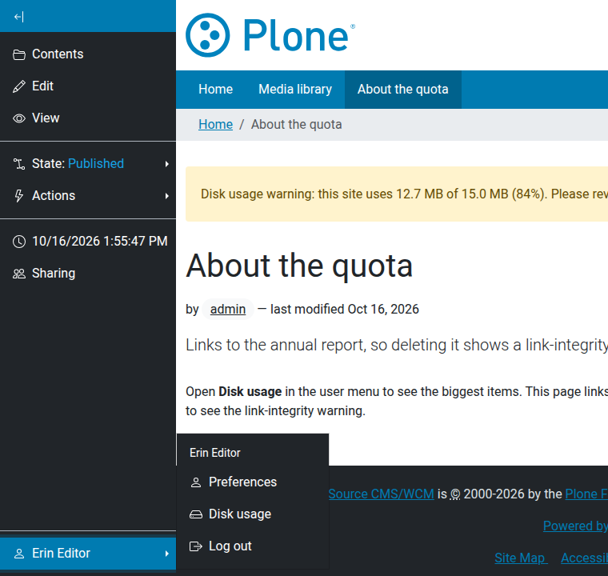 | 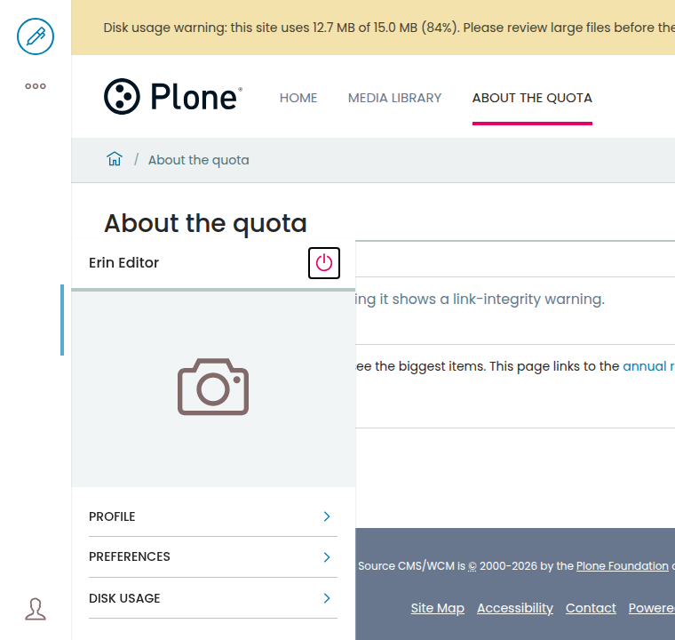 |

### Disk usage page 📊

The page shows the total, a usage bar, the limits and the active policy, then the 10, 25, 50 or 100 biggest items the user can see, with their type, location, size and modification date. Each item links to its view and edit pages.

When no limit is configured, the page still lists the biggest items, with a note that no limits apply.

| Classic UI | Volto |
|---|---|
| 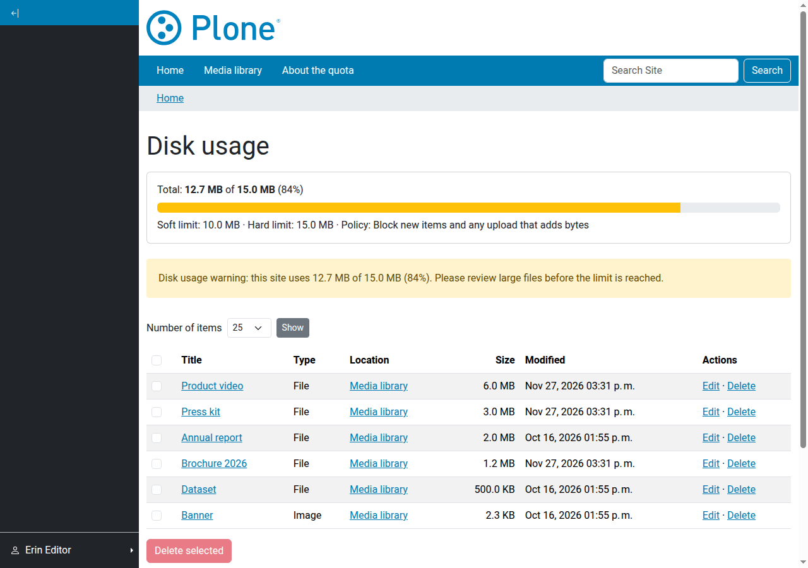 | 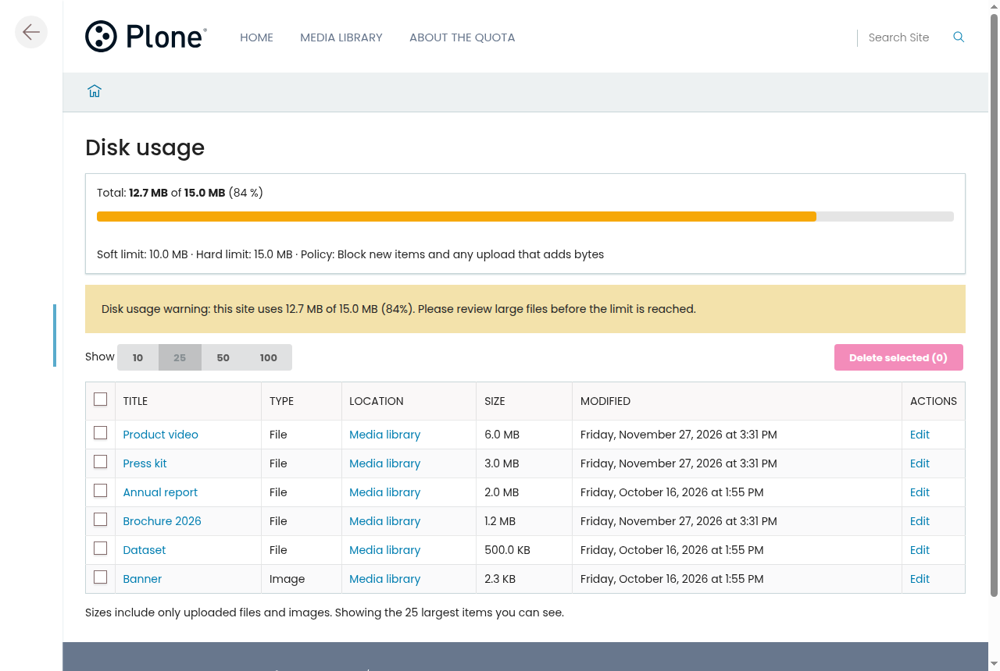 |

### Delete several items at once 🗑️

Select items on the disk usage page and delete them in one go. The confirmation lists what gets deleted and its size, and shows Plone's link-integrity warning when other content links to an item. Afterwards a message reports how much space was freed.

Deleting always works, even over the hard limit, so editors can clean up. Items the user may not delete, or that someone else has locked, are skipped and reported.

| Classic UI | Volto |
|---|---|
| 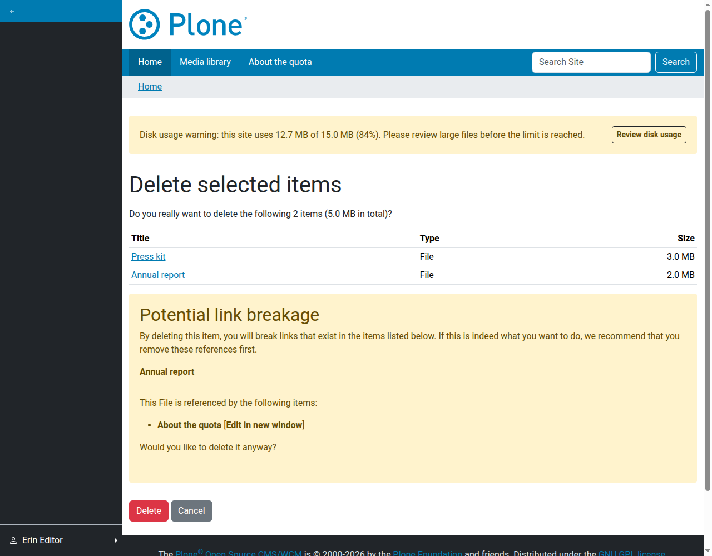 | 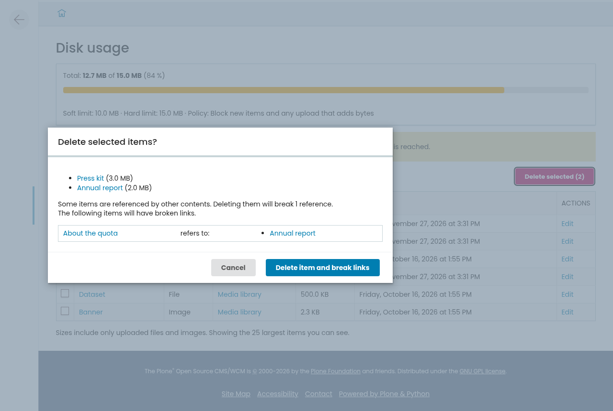 |

### Warning banner 🔔

Once usage reaches the soft limit, editors see a yellow banner on every page, with a link to the disk usage page.

| Classic UI | Volto |
|---|---|
| 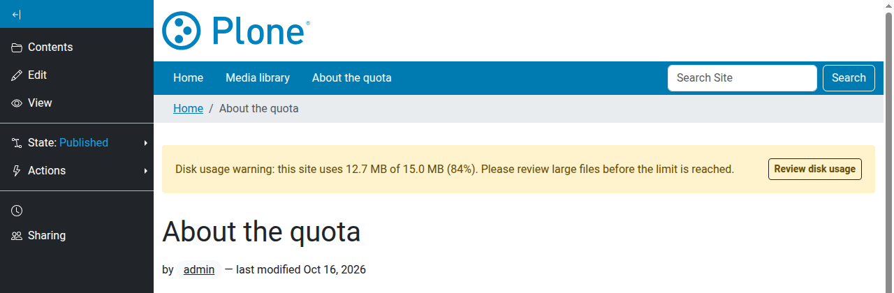 | 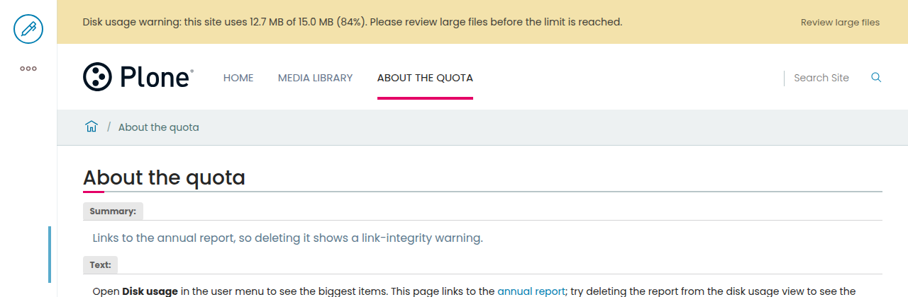 |

At the hard limit the banner turns red and says what the policy now blocks.

| Classic UI | Volto |
|---|---|
| 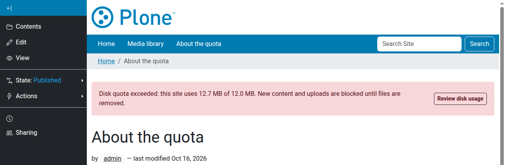 | 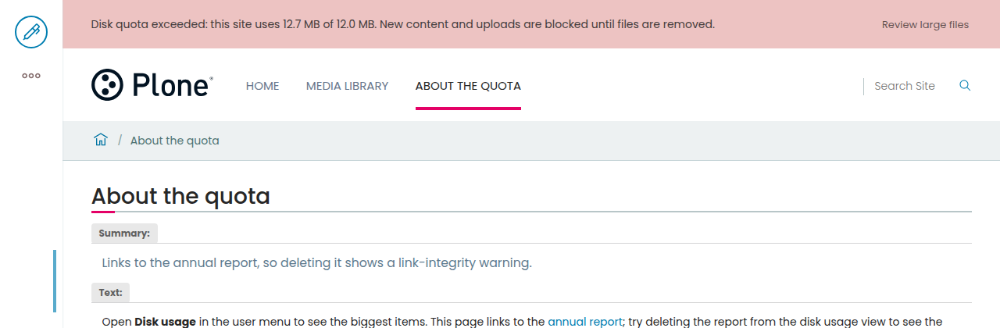 |

The banner is left out of the disk usage page and the control panel, which show the numbers anyway. With no limits configured, there is no banner at all.

### Hard limit enforcement 🚦

A save that would push usage above the hard limit follows the configured policy:

| Policy | New items without files | Uploads that add bytes | Replacing with a smaller file |
|---|---|---|---|
| `block_all` (default) | refused | refused | allowed |
| `block_files` | allowed | refused | allowed |
| `limit_file_size` | allowed | allowed up to the maximum file size | allowed |
| `allow` | allowed | allowed (warnings only) | allowed |

An upload that still fits under the hard limit is always allowed. Add and edit forms show the reason on the file field, and REST clients get `400 Bad Request` with the same message.

| Classic UI | Volto |
|---|---|
| 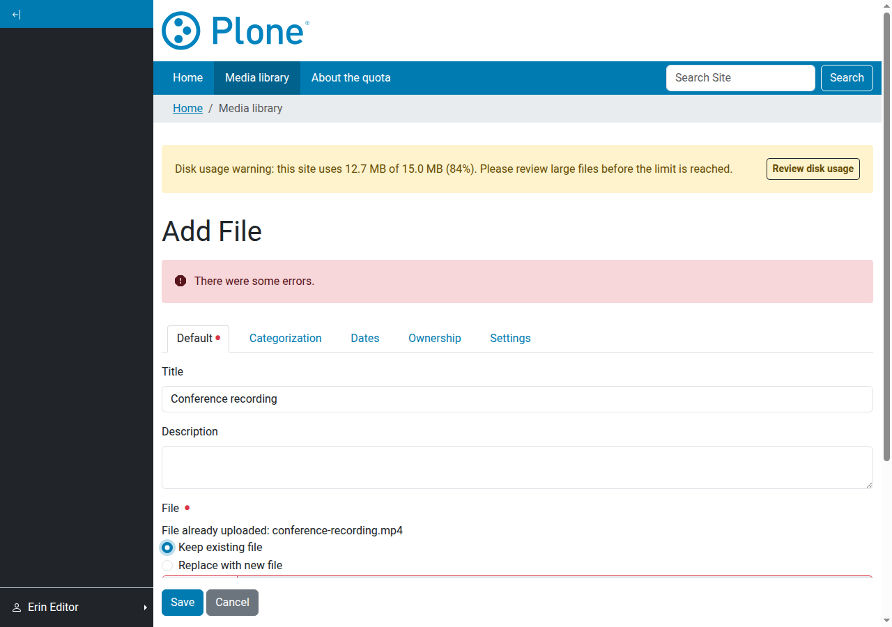 | 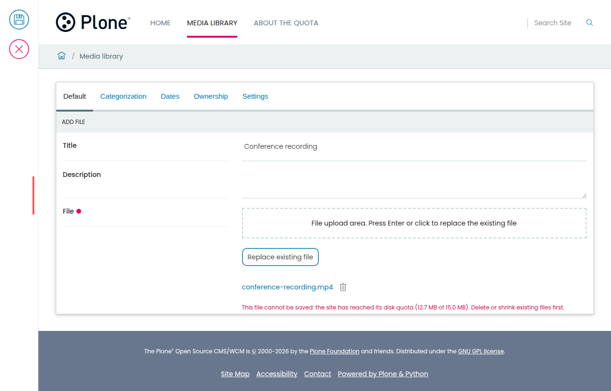 |

A transaction guard also cancels every other change that would cross the limit, such as copy and paste, scripts, imports and other add-ons, so the limit cannot be bypassed. See [Limits and policies](docs/docs/concepts/limits-and-policies.md) and [Run imports over quota](docs/docs/how-to-guides/run-imports-over-quota.md).

### Quota control panel ⚙️

Site administrators set the soft limit, the hard limit, the policy and the maximum file size in **Site Setup → Add-on Configuration → Quota**. The panel also shows:

- the current usage,
- where each value comes from: the control panel, an environment variable or the built-in default,
- **Rebuild usage data**, to recompute the sizes,
- **Reset to defaults**, to clear the values saved in the panel.

| Classic UI | Volto |
|---|---|
| 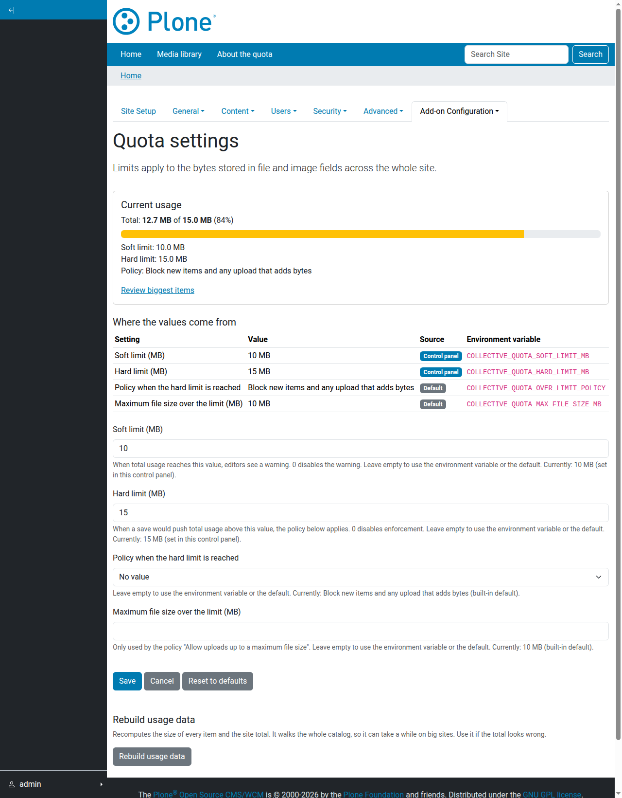 | 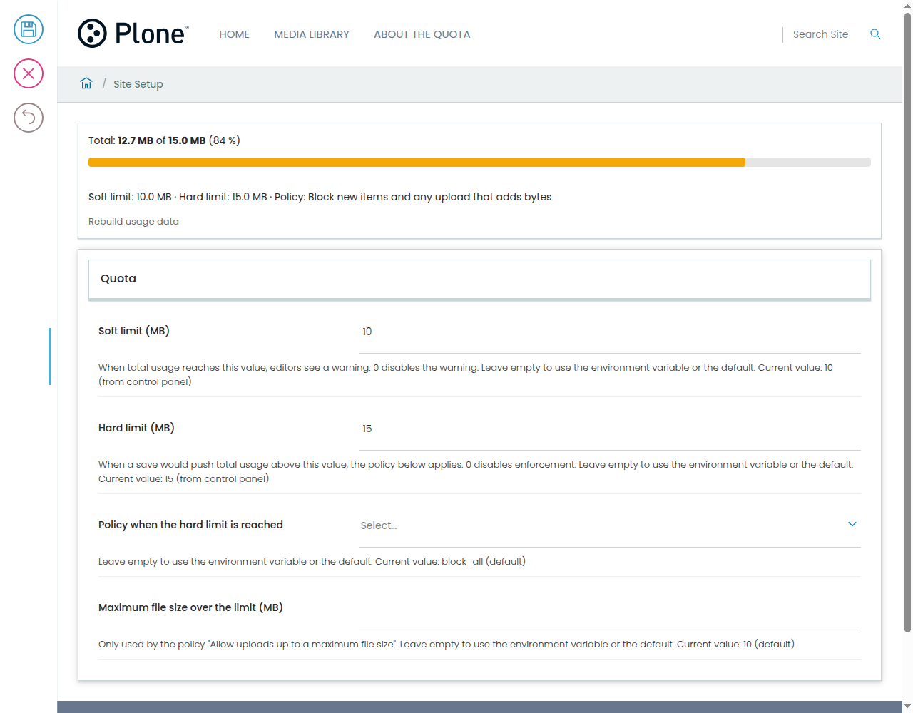 |

### Environment variables and locked settings 🔒

Every setting can also come from a `COLLECTIVE_QUOTA_*` environment variable of the Zope process. By default these act as defaults that the control panel can override.

With `COLLECTIVE_QUOTA_LOCK_SETTINGS` on, the variables that are set become fixed: the control panel shows them as locked and neither the form nor the REST API can change them. This suits hosting setups where the server operator decides the quota.

```shell
COLLECTIVE_QUOTA_HARD_LIMIT_MB=15 \
COLLECTIVE_QUOTA_OVER_LIMIT_POLICY=block_all \
COLLECTIVE_QUOTA_LOCK_SETTINGS=1 \
make backend-start
```

| Classic UI | Volto |
|---|---|
| 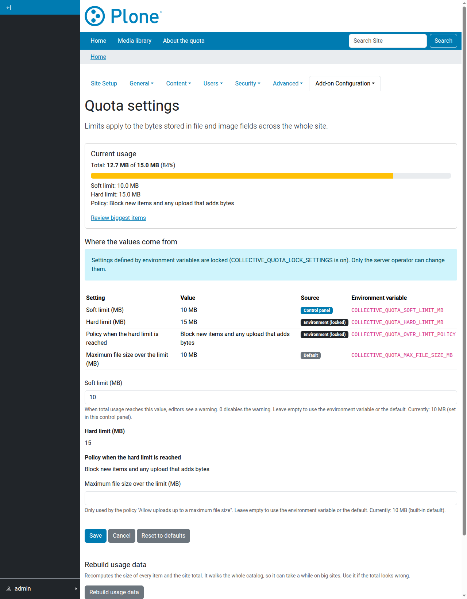 | 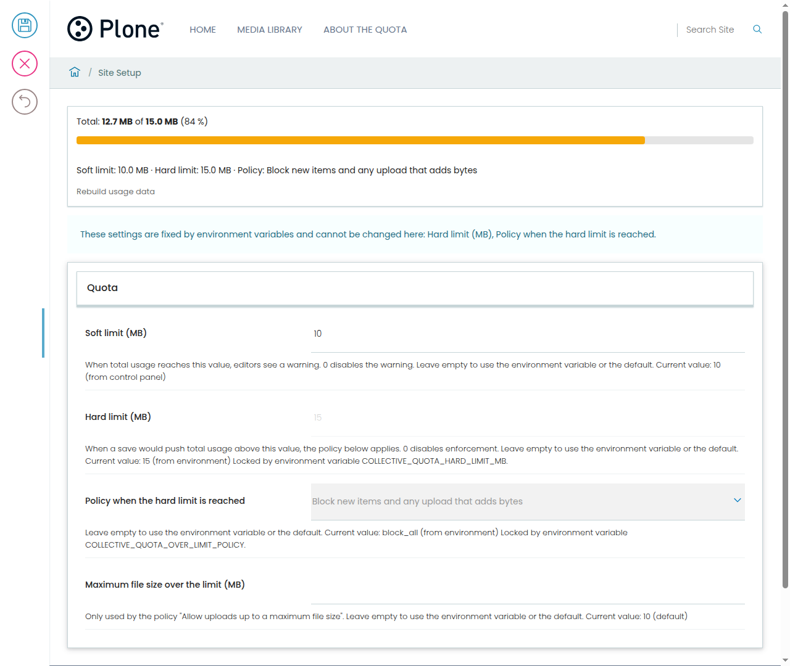 |

See [Environment variables](docs/docs/reference/environment-variables.md) for the full list.

### Permissions 🔐

| Permission | Default roles | Grants |
|---|---|---|
| `collective.quota: Manage Quota Settings` | Manager, Site Administrator | Control panel, "Rebuild usage data" |
| `collective.quota: View Disk Usage` | Manager, Site Administrator, Editor, Contributor, Reviewer | Disk usage page, warning banner, user-menu entry |

Deleting from the disk usage page also needs Plone's `Delete objects` permission on each item.

### REST API 🔌

The Volto add-on uses these endpoints, and so can any other REST client:

| Endpoint | Returns |
|---|---|
| `GET @quota-usage?limit=25` | The usage summary and the biggest items |
| `POST @quota-rebuild` | Rebuilds the usage data and returns the new total |
| `?expand=quota` on any content | The usage summary in `@components.quota` |
| `@controlpanels/collective-quota` | The settings, where each comes from, and which are locked |

See the [REST API reference](docs/docs/reference/rest-api.md).

### And also 🌐

- English and Spanish translations in both halves.
- Uninstalling the backend add-on removes its index, settings and screens. The Volto add-on then hides its menu entry and banner, and its page says that the backend add-on is missing.

See [backend/README.md](backend/README.md), [frontend/README.md](frontend/README.md) and [docs/](docs/) for the full documentation.

## Quick Start 🏁

### Prerequisites ✅

-   An [operating system](https://6.docs.plone.org/install/create-project-cookieplone.html#prerequisites-for-installation) that runs all the requirements mentioned.
-   [uv](https://6.docs.plone.org/install/create-project-cookieplone.html#uv)
-   [nvm](https://6.docs.plone.org/install/create-project-cookieplone.html#nvm)
-   [Node.js and pnpm](https://6.docs.plone.org/install/create-project.html#node-js) 24
-   [Make](https://6.docs.plone.org/install/create-project-cookieplone.html#make)
-   [Git](https://6.docs.plone.org/install/create-project-cookieplone.html#git)


### Installation 🔧

1.  Clone this repository, then change your working directory.

    ```shell
    git clone git@github.com:collective/collective-quota.git
    cd collective-quota
    ```

2.  Install this code base.

    ```shell
    make install
    ```


### Fire Up the Servers 🔥

1.  Create a new Plone site on your first run.

    ```shell
    make backend-create-site
    ```

2.  Start the backend at http://localhost:8080/.

    ```shell
    make backend-start
    ```

3.  In a new shell session, start the frontend at http://localhost:3000/.

    ```shell
    make frontend-start
    ```

Voila! Your Plone site should be live and kicking! 🎉

## Project structure 🏗️

This monorepo consists of the following distinct sections:

- **backend**: The Python add-on `collective.quota`, with a development Plone installation (pip instead of buildout).
- **frontend**: The Volto add-on `volto-collective-quota`.
- **docs**: Scaffold for writing documentation for your project.

### Why this structure? 🤔

- Both halves of the add-on, and what you need to develop and test them, live in one repository.
- Specific GitHub Workflows are triggered based on changes in each codebase (refer to .github/workflows).

## Code quality assurance 🧐

To check your code against quality standards, run the following shell command.

```shell
make check
```

### Format the codebase

To format and rewrite the code base, ensuring it adheres to quality standards, run the following shell command.

```shell
make format
```

| Section | Tool | Description | Configuration |
| --- | --- | --- | --- |
| backend | Ruff | Python code formatting, imports sorting  | [`backend/pyproject.toml`](./backend/pyproject.toml) |
| backend | `zpretty` | XML and ZCML formatting  | -- |
| frontend | ESLint | Fixes most common frontend issues | [`frontend/.eslintrc.js`](.frontend/.eslintrc.js) |
| frontend | prettier | Format JS and Typescript code  | [`frontend/.prettierrc`](.frontend/.prettierrc) |
| frontend | Stylelint | Format Styles (css, less, sass)  | [`frontend/.stylelintrc`](.frontend/.stylelintrc) |

Formatters can also be run within the `backend` or `frontend` folders.

### Linting the codebase
or `lint`:

 ```shell
make lint
```

| Section | Tool | Description | Configuration |
| --- | --- | --- | --- |
| backend | Ruff | Checks code formatting, imports sorting  | [`backend/pyproject.toml`](./backend/pyproject.toml) |
| backend | Pyroma | Checks Python package metadata  | -- |
| backend | check-python-versions | Checks Python version information  | -- |
| backend | `zpretty` | Checks XML and ZCML formatting  | -- |
| frontend | ESLint | Checks JS / Typescript lint | [`frontend/.eslintrc.js`](.frontend/.eslintrc.js) |
| frontend | prettier | Check JS / Typescript formatting  | [`frontend/.prettierrc`](.frontend/.prettierrc) |
| frontend | Stylelint | Check Styles (css, less, sass) formatting  | [`frontend/.stylelintrc`](.frontend/.stylelintrc) |

Linters can be run individually within the `backend` or `frontend` folders.

## Internationalization 🌐

Generate translation files for Plone and Volto with ease:

```shell
make i18n
```

## Developing with Claude 🤖

This product was built with [Claude](https://claude.ai) as a development assistant, following a spec-first workflow. Use the same workflow for new features.

### Specs first, with Claude Fable 5.1

The [`specs/`](specs/) folder holds the plan for everything this repository builds, and in which order. Draft and revise specs with **Claude Fable 5.1** (`claude-fable-5-1`):

- [`specs/00-architecture.md`](specs/00-architecture.md) fixes every name (permissions, views, registry keys, REST endpoints, Volto components), the quota policy, and the product rules that hold across both halves.
- Each phase gets its own file (`specs/phase-NN-*.md`) with a goal, scope, design, list of files, tasks and tests as checkboxes, acceptance criteria and a `Status` line.
- [`specs/README.md`](specs/README.md) lists the phases with their status and the project conventions (commands, 100 % backend coverage, 90 % frontend coverage, i18n, changelog fragments, no Docker images).

Settle the open design questions in the spec before any code is written.

### Implementation, with Claude Opus 5.5

Implement phases one at a time, in order, with **Claude Opus 5.5** (`claude-opus-5-5`) in [Claude Code](https://claude.com/claude-code), working from the specs:

- Read `specs/00-architecture.md` and the phase file first; they are the contract.
- Check off tasks and tests as they land, and move the phase `Status` from `Not started` to `In progress` to `Done`. A phase is `Done` only when every task and test is checked and the acceptance criteria hold.
- When the code shows that a spec is wrong (a library behaves differently, a name does not exist), fix the spec in the same commit, so the documents never lag behind the code.
- Before every commit, run the gates: `make lint` and `make test-coverage` in `backend/`, `make lint` and `make test` in `frontend/`, and the Cypress suite for user-visible flows.

### A person stays in charge

Claude drafts and implements; a developer reviews every spec and commit, runs the manual QA steps listed in each phase file, and decides what is released. Findings from manual testing go back into the specs and the tests, so they are not lost.

## Credits and acknowledgements 🙏

Generated using [Cookieplone (2.0.2)](https://github.com/plone/cookieplone) and [cookieplone-templates (19d0792)](https://github.com/plone/cookieplone-templates/commit/19d07923b43f38bc80271aab3d4ea54388fa9d23) on 2026-10-15 16:57:51.018171. A special thanks to all contributors and supporters!
